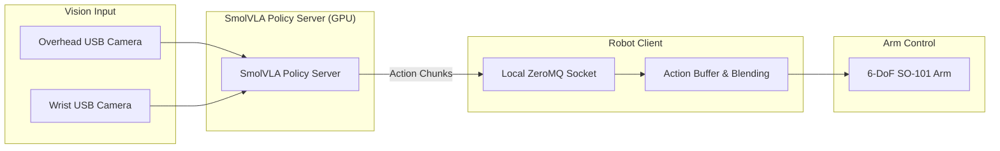

EE5111 Intelligent Robotics major project, University of Galway (supervisor: Dr. Brian Deegan). [Code and thesis](https://github.com/akshitharsola/learning-to-pick-lerobot-so101)

## Problem
Pick a strawberry and place it in a bin using imitation learning on low-cost open hardware (a 6-DoF SO-101 arm, two USB cameras). The project compares three policy types trained on teleoperated demonstrations: Action Chunking with Transformers (ACT), Diffusion Policy, and SmolVLA, a 450M-parameter vision-language-action model.

## First attempt: AL5D arm with ROS 2
The project started on a Lynxmotion AL5D arm in a ROS 2 pipeline: an OAK-D Lite camera streamed to an Ubuntu 24.04 VM over ZeroMQ, an HSV ball detector, analytical 4-DOF inverse kinematics and a servo controller node for two-camera visual servoing. It was abandoned because the arm itself was defective: commanded to reach a point such as (20, 0) on a flat surface, it went somewhere else. I attribute this to a manufacturing defect in the arm, not to the software, and the project moved to the SO-101 and LeRobot.

## Pipeline
Two cameras (overhead and wrist) feed a SmolVLA policy server on a GPU. It returns action chunks over a local ZeroMQ socket to a robot client that drives the SO-101. The client queues and blends chunks, so inference does not block the control loop.

## Results
- **Baseline policies on a cube task:** ACT succeeded 1 of 10 and Diffusion Policy 4 of 10. The cause was traced to a physically shifted wrist-camera mount, not to the policies. The policies were retrained on a fixed 42-episode dataset, but no per-episode success table was logged for that round.
- **Final policy (strawberry):** SmolVLA, fine-tuned in stages, succeeded in 8 of 10 trials (80%, 95% Wilson interval 49-94%). Both failures were grasps in the known slip zone at the strawberry's bottom tip.
- **Scale of the claim:** this is a pilot result, not a validated benchmark. Narrowing the interval would need roughly 50-100 trials or more.

## Engineering notes
- **Asynchronous control:** synchronous SmolVLA rollout ran at only 4.3-4.7 Hz. The async server/client split removed the fixed-rate dependence.
- **Diffusion sampling:** 100-step DDPM held control to 0.9 Hz. Switching to 5-step DDIM raised it to 13.5 Hz and grasp success from 10% to 70%.
- **Real fruit abandoned:** real strawberries were crushed or torn by the gripper, so the final task uses a printed strawberry prop with a grasp rule (stem or mid-body, never the bottom tip).
- **Training on a Jetson AGX Orin:** about 8 GB of free storage, so a background pruner bounded disk use while checkpoints streamed to Hugging Face Hub.
- **Data:** 84 episodes (59,865 frames) in the final combined dataset. Models and datasets are on Hugging Face under `Akshit03`.

## What I'd do next
- Run 50-100+ trials for a benchmark-grade success rate.
- Fix the bottom-tip slip zone, for example with a compliant fingertip (judged infeasible in the project's remaining time).
- 
